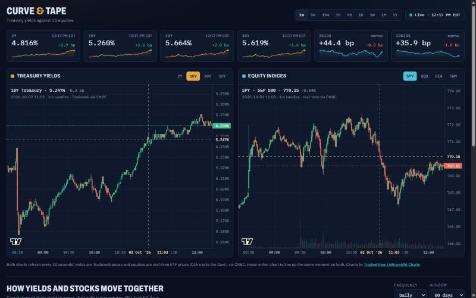

# Curve & Tape

A live dashboard showing how US Treasury yields (2Y, 10Y, 20Y, 30Y) move against the major equity
indices (SPY, QQQ, DIA, IWM).



## Features
- **Live candles for yields and equities** from 1-minute to yearly, on one shared interval control
- **Linked charts:** hover or scroll one chart and the other follows to the same moment
- **Yield strip:** live 2Y/10Y/20Y/30Y with daily change, plus 2s10s and 10s30s curve spreads
- **Correlation matrix:** every yield against every index (hourly, daily, weekly or monthly) with
  change from the previous window; click a cell to load that pair
- **Rate sensitivity:** the average index move per +10bp rise in yield, with a plain-English reading
- **Rolling correlation** and **curve shape** charts
- Plain HTML, CSS and JavaScript with no build step; two small serverless functions relay the data

## Data
| What | Source |
|---|---|
| Yield candles, 1m → 1Y, and live quotes | Tradeweb via CNBC's quote/bar feed, relayed by `api/cnbc.js` |
| Prices for correlation (daily and hourly) | Same CNBC feed |
| Equity candles, 1m → 1Y, real-time | Same CNBC feed |
| Backup yields if the feed is down | FRED daily closes via `api/fred.js` |

Charts are drawn with TradingView Lightweight Charts and share one interval, crosshair and time range.
The page refreshes every 30 seconds. 15m and 4h candles are built from 5m and 1h bars, and the
current day's candle comes from the live quote until the daily bar posts after the close.

**Caution:** the CNBC feed is undocumented and unofficial. It can change or stop without notice, and
republishing it on a public site may conflict with CNBC's terms. For a commercial or high-traffic site,
swap `api/cnbc.js` for a licensed feed.

## Run locally
```
python serve.py
```
Open http://localhost:8787. `serve.py` mirrors both `/api` functions.

## Deploy (free) on Vercel
1. Push this folder to a GitHub repo.
2. In Vercel: New Project → import the repo → Deploy (no build settings needed).
   `index.html` is served as the site, and `api/cnbc.js` and `api/fred.js` become `/api/cnbc` and `/api/fred`.

## Ideas for next
- FOMC / CPI / jobs-report markers on the charts
- Overlay a yield line on the equity chart
- Share links that encode the selected pair and interval
