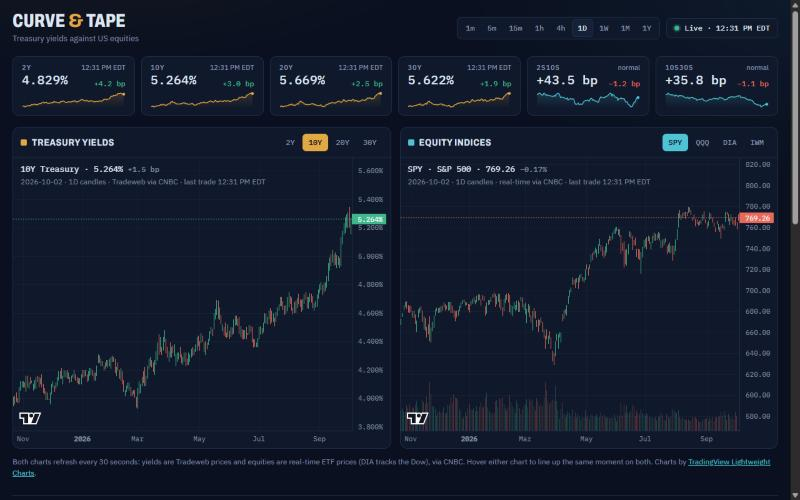
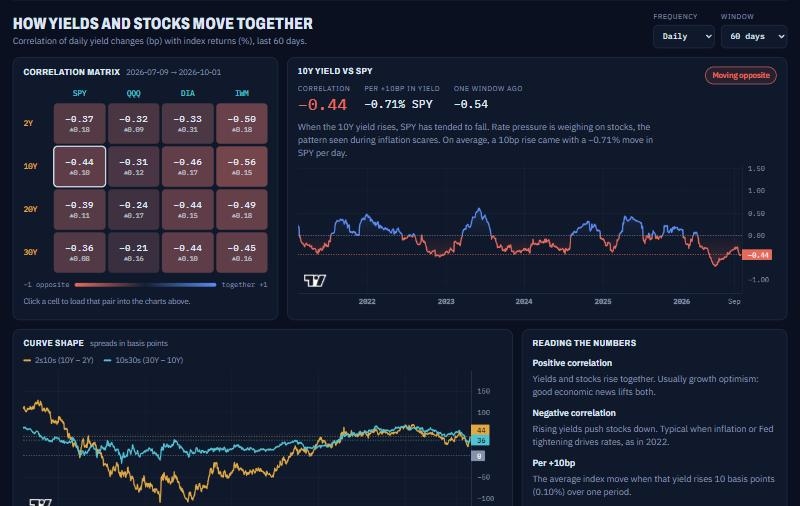

# Curve & Tape

A live dashboard showing how US Treasury yields (2Y, 10Y, 20Y, 30Y) move against the major equity
indices (SPY, QQQ, DIA, IWM).



## Features

### Live yields and equities, side by side
- **Yield strip:** live 2Y, 10Y, 20Y and 30Y yields with the day's change in basis points and a
  six-month sparkline, plus the 2s10s and 10s30s curve spreads (flagged when inverted)
- **Candle charts** for any maturity (left) and SPY, QQQ, DIA or IWM (right), refreshed every 30 seconds
- **One interval control** for both charts: 1m, 5m, 15m, 1h, 4h, 1D, 1W, 1M, 1Y

### Linked charts
Hover a candle on either chart and the other marks the same moment; scroll or zoom one and the other
follows. Below, at 11:03 the 10Y was 5.247% and SPY was 770.15.


### Correlation workbench
- **Correlation matrix:** every yield against every index, with the change since the previous window.
  Click a cell to load that pair into the charts
- **Hourly, daily, weekly or monthly** frequency, with a choice of window length
- **Rate sensitivity:** the average index move for every +10bp rise in yield
- **Plain-English reading** of the current relationship (moving together, moving opposite or weak link)
- **Rolling correlation** chart to show how the relationship has shifted over time
- **Curve shape** chart of the 2s10s and 10s30s spreads



### Built simply
Plain HTML, CSS and JavaScript with no build step. Two small serverless functions relay the market data,
and the page falls back to FRED daily yields automatically if the live feed is down.

## Data
| What | Source |
|---|---|
| Yield candles, 1m → 1Y, and live quotes | Tradeweb via CNBC's quote/bar feed, relayed by `api/cnbc.js` |
| Prices for correlation (daily and hourly) | Same CNBC feed |
| Equity candles, 1m → 1Y, real-time | Same CNBC feed |
| Backup yields if the feed is down | FRED daily closes via `api/fred.js` |

Charts are drawn with TradingView Lightweight Charts and share one interval, crosshair and time range.
The page refreshes every 30 seconds. 15m and 4h candles are built from 5m and 1h bars, and the
current day's candle comes from the live quote until the daily bar posts after the close.

**Caution:** the CNBC feed is undocumented and unofficial. It can change or stop without notice, and
republishing it on a public site may conflict with CNBC's terms. For a commercial or high-traffic site,
swap `api/cnbc.js` for a licensed feed.

## Run locally
```
python serve.py
```
Open http://localhost:8787. `serve.py` mirrors both `/api` functions.

## Deploy (free) on Vercel
1. Push this folder to a GitHub repo.
2. In Vercel: New Project → import the repo → Deploy (no build settings needed).
   `index.html` is served as the site, and `api/cnbc.js` and `api/fred.js` become `/api/cnbc` and `/api/fred`.

## Ideas for next
- FOMC / CPI / jobs-report markers on the charts
- Overlay a yield line on the equity chart
- Share links that encode the selected pair and interval
